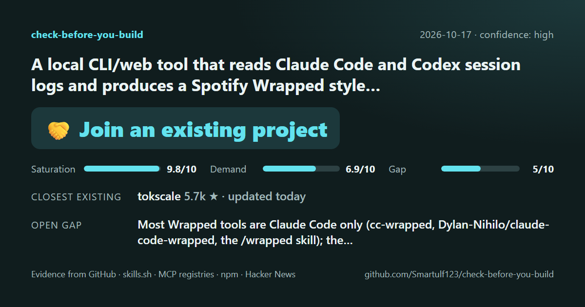

# check-before-you-build

**Is this worth building, and what can I build it with?**

An open-source agent skill that checks your idea against GitHub, skills.sh, Claude plugin marketplaces, MCP registries, npm, PyPI and Hacker News. It gives you a cited verdict and the best existing repos to build on.



---

## Why

Building is cheap now. The expensive mistake is spending a weekend, or a month, on something that already exists or that nobody wants.

Most idea validators give you an opinion about market size. This one shows you **evidence**:

- **Does it already exist?** Real repos, skills, MCP servers and packages, with live stars, last-commit dates and licenses. The agent reads their READMEs before judging them.
- **Does anyone want it?** Hacker News threads, feature requests on competitors' issue trackers and questions on the web, each with a link.
- **Where's the gap?** What existing projects lack, backed by evidence.
- **What should I build it with?** A curated catalog of 1,174 quality-checked repos tells you what to 🧱 use, 🍴 fork, 💡 learn from or 🤝 contribute to.

## Install

With the open [skills](https://skills.sh) CLI (Claude Code, Codex, OpenCode, Cursor and others):

```bash
npx skills add Smartulf123/check-before-you-build
```

Or as a Claude Code plugin:

```
/plugin marketplace add Smartulf123/check-before-you-build
/plugin install check-before-you-build@check-before-you-build
```

Requirements: Node 20 or newer. An authenticated [`gh`](https://cli.github.com/) CLI is strongly recommended (GitHub allows 10 searches a minute without it, 30 with it). No paid API keys.

## Use

Just describe what you're about to build:

```
Does this already exist? A CLI that turns my time logs into invoices.
```

```
/check-before-you-build A skill that extracts a website's design into DESIGN.md --deep
```

Modes: `--quick` (catalog and GitHub only), standard (default) and `--deep` (more queries and issue mining). Purpose: `--for fun`, `--for me` or `--for launch`.

## What you get

A real run, for *"A Spotify Wrapped style yearly recap for AI coding agents like Claude Code and Codex, made from local session logs, to share on social media"*:

```
🤝 YOU COULD JOIN AN EXISTING PROJECT   (confidence: high)
Saturation 9.8/10 · Demand 6.9/10 · Gap 5/10

Closest existing: tokscale (5.7k ⭐, updated today, MIT) already has a
`wrapped` command for Claude Code and Codex logs, but its card is about tokens and cost.
Also: coding-wrapped, cc-wrapped, claude-code-wrapped, a /wrapped skill (all small)
Open gap: storytelling recaps (archetypes, habits, what you built) exist only in tiny,
mostly Claude-only projects; the PNG ones haven't been updated since December 2025.
Building blocks: 🧱 Satori · 🧱 resvg-js · 🧱 Ink · 🤝 tokscale · 💡 ccusage, cc-wrapped
Fact-check: 34/34 items verified · 32 candidates evaluated

Next step: propose a story-mode Wrapped to tokscale, or build your own
local-only, Codex-first version before December.
```

Every run writes three files to `check-reports/<date>-<slug>/`:

- `report.md`: the full report with every source linked
- `evidence.json`: machine-readable evidence, scores and verification log
- `card.html`: a shareable 1200×630 verdict card

### Building for fun? It won't stop you.

Building something that already exists is how most people learn. The tool informs, it never forbids. Tell it why you're building and the report adapts:

| | Purpose | What you get |
|---|---|---|
| 🎓 | `--for fun`: fun or learning | No verdict. Projects worth learning from, plus the right building blocks. |
| 🛠️ | `--for me`: a tool for yourself | A short "these might save you time" hint, plus building blocks. |
| 🚀 | `--for launch`: publishing for users | The full verdict, always with a way forward. |

If you don't say, it works out the purpose from how you describe the idea.

## How it works

1. **Understand** the idea: summary, form factor, search terms from five angles (your words, developer jargon, business words, the problem, bigger tools that might include it), components.
2. **Supply**: search the catalog, GitHub, skills.sh, plugin marketplaces, MCP registries, npm and PyPI, and read the READMEs of the closest matches.
3. **Demand**: Hacker News, competitors' GitHub issues weighted by 👍, the web.
4. **Gaps**: what existing projects lack, each with evidence. The gap score is capped by how much evidence there is.
5. **Building blocks**: catalog first, then live search. Every recommended repo's README is read first, and recommendations respect licenses.
6. **Fact-check, then score**: every cited repo, package and link is re-checked before scoring. Fake or renamed repos are dropped or fixed. Then fixed rules compute the verdict from the evidence; the model never writes it.
7. **Write**: report, evidence file and card.

The agent does the reasoning. Small, dependency-free Node scripts fetch the facts, so numbers come from APIs, not from model memory.

### Verdicts

| Verdict | Means |
|---|---|
| ✅ Open space | Little supply, real demand: go build it |
| 🔀 Build with an angle | It exists, but there's an evidenced gap |
| 🤝 Join an existing project | An active, adopted, permissive project already does most of it |
| 🍴 Revive an abandoned project | The leader is archived or inactive and forkable |
| 📚 Already well covered | Saturated with no gap, or no sign of demand |
| ❔ Mixed signals | The evidence doesn't point one way |

Rules and formulas: [scoring.md](skills/check-before-you-build/references/scoring.md).

## The catalog

1,174 repos in 50 building-block categories across 20 domains, from web frameworks and AI agents to audio, 3D printing and games. Every entry:

- passes one quality gate: adoption (for example 1,000+ stars), a commit in the last 6 months (18 for stable, widely used projects), a real license, 3+ contributors and a fake-star check
- has a summary, best-for and not-for written from its README, and checked against it
- costs you no GitHub API calls: stats come from a weekly snapshot

The catalog is updated weekly. Suggest a repo with an issue.

## Evaluation

The skill is tested end to end by fresh agents on a fixed set of ideas, graded on whether it finds known competitors and lands on a sensible verdict. Results: [evals/RESULTS.md](evals/RESULTS.md).

## Principles

- **Evidence over opinion**: every claim links to a source.
- **Free**: no paid API keys.
- **Local and read-only**: no telemetry, no posting, no scraping of login-walled platforms. Your idea is only sent to the public search APIs listed above.
- **Portable**: the open Agent Skills format, so it runs in Claude Code, Codex, OpenCode and other agents.

## Roadmap

- [x] Fact scripts, rule-based scoring, fact-checking, verdict card
- [x] Catalog: 1,174 repos with README-based descriptions
- [x] v1.0.0
- [ ] Weekly catalog updates in CI
- [ ] More sources (Product Hunt, VS Code marketplace, crates.io)
- [ ] Watch mode: re-check an idea later and show what changed

## Contributing

Issues and PRs are welcome: missing repos for the catalog, sources that should be searched, or a verdict you think was wrong (attach the `evidence.json`). Run the tests with `npm test`.

## License

[MIT](LICENSE)
